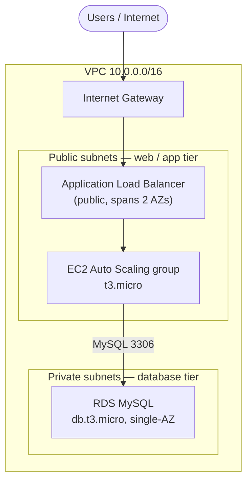

# AWS two-tier architecture (Free Tier)

A minimal, **AWS Free Tier friendly** two-tier web application, defined with Terraform.

- **Tier 1 — web/app (public):** an internet-facing Application Load Balancer in front of an EC2 Auto Scaling group in public subnets.
- **Tier 2 — database (private):** a single-AZ RDS MySQL instance in private subnets with no route to the internet.

Security groups are chained so the database only ever accepts connections from the web tier, and the web tier only accepts traffic from the load balancer.

## Architecture



## What stays inside the Free Tier

| Resource | Config | Free Tier (first 12 months) |
|---|---|---|
| EC2 | 1× `t3.micro`, running 24/7 | 750 hrs/month — one instance covered |
| RDS | `db.t3.micro`, 20 GB gp2, single-AZ | 750 hrs/month + 20 GB covered |
| ALB | 1 load balancer | 750 hrs/month + 15 LCU covered |
| VPC, subnets, IGW, route tables, security groups | — | always free |

**Cost caveats — read these:**
- These allowances are **free for your first 12 months** only. After that, the ALB is ~\$16/month and RDS/EC2 are billed hourly.
- **No NAT Gateway** is created (it is *not* free — ~\$32/month). That means the private DB tier has no outbound internet, which is fine for RDS.
- Keep **one** EC2 instance and **single-AZ** RDS. Raising `desired_capacity` above 1, or setting `multi_az = true`, will exceed the Free Tier.
- Always run `terraform destroy` when you're done experimenting so nothing bills overnight.

## Prerequisites

- An AWS account (new accounts get the 12-month Free Tier).
- [Terraform](https://developer.hashicorp.com/terraform/install) >= 1.5
- AWS credentials configured (`aws configure`, or environment variables).

## Usage

```bash
# 1. Set your DB password without committing it:
export TF_VAR_db_password='a-strong-password-here'

# 2. (Optional) copy the example vars and edit region / IP allowlist:
cp example.tfvars terraform.tfvars   # terraform.tfvars is gitignored

# 3. Deploy:
terraform init
terraform plan
terraform apply

# 4. Open the URL it prints:
terraform output load_balancer_url

# 5. Tear everything down when finished:
terraform destroy
```

It can take a few minutes after `apply` for the RDS instance to come online and the load balancer health check to go green.

## Repo layout

| File | Purpose |
|---|---|
| `providers.tf` | Terraform + AWS provider config |
| `variables.tf` | All inputs (region, sizes, DB creds) |
| `network.tf` | VPC, subnets, IGW, route tables |
| `security.tf` | The three chained security groups |
| `compute.tf` | ALB, target group, launch template, Auto Scaling group |
| `database.tf` | RDS subnet group + MySQL instance |
| `userdata.sh` | Boot script for the web instances |
| `outputs.tf` | Load balancer URL + DB endpoint |

## Security notes

- The DB password and `*.tfstate` are **gitignored** — state can contain secrets, so never commit it.
- For a real project, store state remotely (e.g. an S3 backend with a DynamoDB lock) and keep secrets in SSM Parameter Store or Secrets Manager.
- Set `my_ip_cidr` to your own IP to stop the whole internet from reaching the load balancer.

## License

MIT — do whatever you like.
